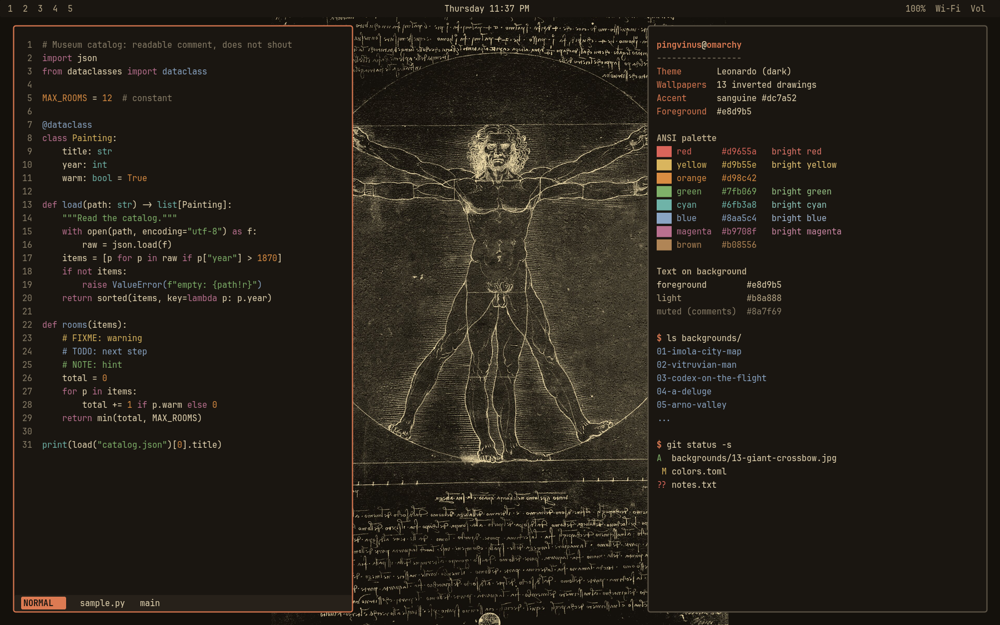
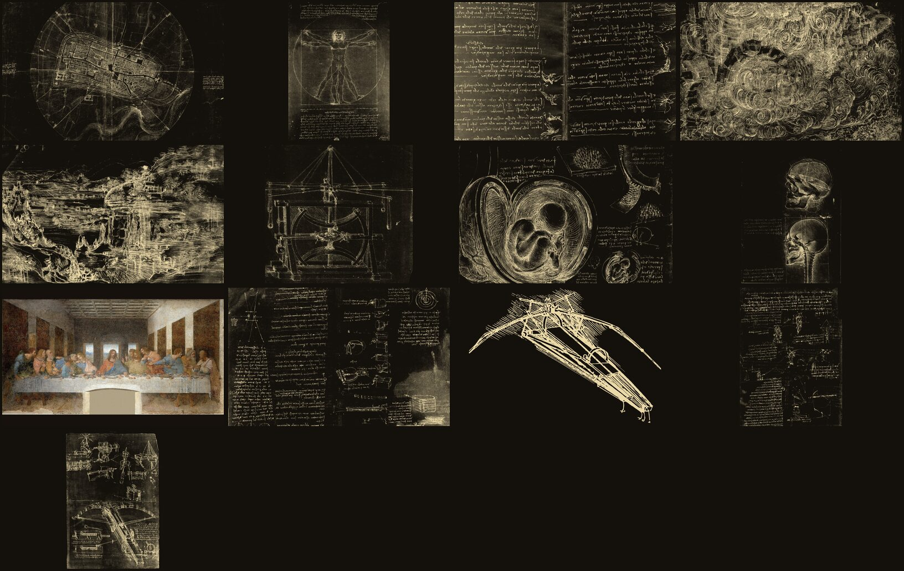

# Leonardo, an Omarchy theme

A dark [Omarchy](https://omarchy.org) theme for engineers and inventors: thirteen
wallpapers made from Leonardo da Vinci's drawings and one painting, with a palette
of warm parchment, iron-gall umber and sanguine (red chalk).



> The preview is rendered from `colors.toml` on top of one of the wallpapers.
> It is a stylised mock-up, not a screenshot.

## Install

```bash
omarchy-theme-install https://github.com/andreiyurik/omarchy-leonardo-theme
omarchy-theme-set leonardo
```

## What you get

- **13 wallpapers**, all 16:10 (3840x2400 or the largest size the source allows).
- **A palette** derived from the drawings: umber background `#1a1611`, chalk-parchment
  text `#e8d9b5`, sanguine accent `#dc7a52`.
- **A thin flat window border** in the accent colour instead of a gradient frame.
- **Yaru-wartybrown icons.**



## Wallpapers

Drawings are inverted so that the ink becomes light lines on a dark ground (like
chalk on a slate board), and the paper becomes the background colour. Portrait
pages are placed whole in the centre of the screen so that nothing is cropped;
landscape pages are cropped to 16:10. The Last Supper is the only picture left in
its original colours.

| # | File | Work | Wikimedia Commons source file |
|---|------|------|-------------------------------|
| 01 | `01-imola-city-map` | Plan of Imola (map, 1502) | Leonardo da Vinci - Plan of Imola - Google Art Project.jpg |
| 02 | `02-vitruvian-man` | Vitruvian Man (Gallerie dell'Accademia, Venice) | Da Vinci Vitruve Luc Viatour.jpg |
| 03 | `03-codex-on-the-flight-of-birds` | Codex on the Flight of Birds | Da Vinci codex du vol des oiseaux Luc Viatour.jpg |
| 04 | `04-a-deluge` | A Deluge (Royal Collection, Windsor) | Leonardo da Vinci - A deluge - Google Art Project.jpg |
| 05 | `05-arno-valley-landscape` | Landscape of the Arno valley, 1473 (Uffizi) | Paysage de la vallée de l'Arno, Leonard de Vinci (Uffizi, inv. 8 P).jpg |
| 06 | `06-mechanical-study-flywheel` | Mechanical study (flywheel) | Vinci, Leonardo Da - Volano (meccanica).jpg |
| 07 | `07-studies-of-the-foetus` | Studies of the foetus in the womb | Leonardo da Vinci - Studies of the foetus in the womb.jpg |
| 08 | `08-the-skull-sectioned` | The skull sectioned (RCIN 919057) | Leonardo da Vinci - RCIN 919057, Recto The skull sectioned.jpg |
| 09 | `09-the-last-supper` | The Last Supper (colour) | Leonardo da Vinci (1452-1519) - The Last Supper (1495-1498).jpg |
| 10 | `10-codex-arundel` | Codex Arundel, ff. 174v-175r | Codex Arundel 263 ff.174v-175r.jpg |
| 11 | `11-ornithopter-design` | Ornithopter (a clean line redrawing, not a manuscript page) | Ornithopter Leonardo da Vinci.png |
| 12 | `12-codex-atlanticus-f1058v` | Codex Atlanticus, f. 1058 verso | Leonardo da Vinci - Ambrosiana-Codice-Atlantico-Codex-Atlanticus-f-1058-verso.jpg |
| 13 | `13-giant-crossbow` | Giant crossbow, page of a notebook (reproduction, Library of Congress) | Reproduction of page from notebook of Leonardo da Vinci showing giant crossbow LCCN2006681087.tif |

Leonardo died in 1519, so the works are in the public domain, and Wikimedia Commons
marks these reproductions as public domain. Some collections (for example the
Biblioteca Ambrosiana, which holds the Codex Atlanticus) may restrict reuse of
their images under local law; check before you redistribute them commercially.

### How they were made

The sources are the Commons files above. Every drawing goes through roughly this
ImageMagick pipeline (the page margins were trimmed by hand first):

```bash
magick page.png -colorspace Gray -contrast-stretch 0.5%x0.5% -negate \
  -level 22%,100% +level-colors '#14110c,#ecd9a8' \
  -resize x2400 -background '#14110c' -gravity center -extent 3840x2400 \
  -quality 85 out.jpg
```

## Palette

Contrast ratios (WCAG) are measured against the background `#1a1611`.

| Role | Colour | Contrast |
|------|--------|----------|
| foreground | `#e8d9b5` | 12.9 |
| accent (sanguine) | `#dc7a52` | 6.0 |
| muted (comments) | `#8a7f69` | 4.6 |
| red | `#d9655a` | 5.1 |
| yellow | `#d9b55e` | 9.2 |
| orange | `#d98c42` | 6.7 |
| green | `#7fb069` | 7.1 |
| cyan | `#6fb3a8` | 7.5 |
| blue | `#8aa5c4` | 7.1 |
| magenta | `#b9708f` | 5.0 |
| brown | `#b08556` | 5.4 |

A colour-blindness simulation (Machado matrices, approximate) shows the least
distinct pairs are red/green under deuteranopia (distance 7.0 in CIELAB) and
cyan/magenta (9.4); the rest are further apart.

## Русский

Тёмная тема для Omarchy в инженерном стиле: 13 обоев из рисунков Леонардо да Винчи
(чертежи инвертированы: светлые линии на тёмном фоне) и «Тайная вечеря» в цвете.
Палитра: умбра, пергамент и сангина. Установка:

```bash
omarchy-theme-install https://github.com/andreiyurik/omarchy-leonardo-theme
omarchy-theme-set leonardo
```

## License

Theme files: MIT. Artwork: public domain (see above).
